# R2 数据表结构说明

本文记录通过独立仓库 [final-fantasy-resonance-export](https://github.com/AutoGamePlaying/final-fantasy-resonance-export)（`FFR_DEPS="$PWD/.deps" ../final-fantasy-resonance-export/scripts/run.sh export --prefix FFRS/Content/Datatable/`）导出的 JSON 结构（对应 `docs/plan.md` §3 R2），由只读统计命令 `node src/host/cli/data-survey.ts` 核对得出。所有游戏数据文件留在 `.deps/ffr/export/`，不进版本库；本文只描述路径、类型、行数、字段名与表间关联，不包含游戏正文内容。

## 一、导出总览与文件格式

导出目录 `.deps/ffr/export/FFRS/Content/Datatable/` 共 **2618** 个 JSON 文件，每个文件都是长度为 1 的 CUE4Parse 导出数组，对象类型分布如下：

| 对象类型 | 数量 | 说明 |
| --- | ---: | --- |
| `DataTable` | 1704 | 普通数据表；`Properties.RowStruct.ObjectName` 均为 `Class'<StructName>'`，行数据在 `Rows` 对象中 |
| `StringTable` | 870 | 文本资源表；词条在 `StringTable.KeysToEntries`，命名空间在 `StringTable.TableNamespace` |
| `CompositeDataTable` | 20 | 复合数据表；`Properties.ParentTables` 列出上游分表，CUE4Parse 已把合并后的行直接导出到 `Rows` |
| 其他 `DataAsset` / `PrimaryAssetLabel` | 24 | `CPP_DA_*`（22 个）与 `PrimaryAssetLabel`（2 个），不含 `Rows` |

全表主索引位于根目录 `CDT_AppDataTableList_Prod.json`（164 行，`RowStruct = APP_DATA_TABLE_LIST_DATA`），把 `eDataTableType::*` 枚举映射到各生产表的 `/Game/Datatable/...` 路径。

## 二、全部分类总表（共 32 类）

> 31 个子目录加上 `Datatable/` 根目录的 4 张总索引表，共 32 类。

| 分类 | 文件数 | 关键表名（示例） | 关键表行数 | 用途 |
| --- | ---: | --- | ---: | --- |
| `(root)` | 4 | `CDT_AppDataTableList_Prod`、`DT_PreLoadDataTableList` | 164 / 4 | 全局数据表注册索引与预加载清单 |
| `Achievement` | 1 | `DT_AchievementCondition` | 16 | 成就解锁条件参数 |
| `Activity` | 1 | `DT_ActivityData` | 9 | 序章与第 1–8 章检查点及主线进度区间 |
| `Asset` | 54 | `CDT_SkillAsset_Prod`、`DT_BtlUnitAsset`、`DT_MapUnitAsset` | 1355 / 718 / 380 | 技能、角色、地图、音效与 AI 的资源软引用 |
| `Battle` | 18 | `DT_BtlUnitDesignParameter`、`DT_BtlHitEffectData`、`DT_BtlMessageData` | 595 / 592 / 38 | 战斗表现、受击特效、语音、镜头与战斗提示 |
| `Camera` | 1 | `DT_CameraShakeData` | 44 | 镜头震动参数 |
| `Chat` | 118 | `CDT_ChatEventData` 及 `Text/` 下 114 张表 | 107 / 共 710 | 地图探索自动闲聊触发与台词 |
| `Color` | 5 | `CDT_CommonColor`、`DT_StatusColor` | 39 / 20 | UI 与异常状态配色 |
| `Constant` | 1 | `DT_ConstantValueData` | 4 | 全局常量数值 |
| `Difficulty` | 1 | `DT_GameDifficultyParam` | 3 | 难度参数倍率 |
| `DLC` | 1 | `DT_DLCItemData` | 3 | DLC 道具领取配置 |
| `Encount` | 110 | `DT_BattleGroup`、`DT_BattleUnitLayout`、101 张分区域遇敌表 | 678 / 54 / 共 596 | 遇敌池、敌人编组、站位坐标与遇敌演出 |
| `Event` | 913 | `CDT_TalkEventData_Prod`、812 张 `Text/` 对话表、`DT_BtlEventDataBundle` | 3442 / 共 35757 / 45 | 剧情事件定义、对话脚本、战斗事件、旗标与进度变更 |
| `Flag` | 10 | `CDT_FlagCondition`、系统与第 1–8 章分表 | 38 / 合计 76 | 命名旗标布尔条件表达式 |
| `INN` | 1 | `DT_InnList` | 1 | 旅店住宿配置 |
| `Item` | 9 | `DT_EquipmentItemData`、`DT_ConsumablesItemData`、`DT_ValuableItemData`、`Vision/DT_VisionItemData` | 454 / 51 / 37 / 26 | 消耗品、装备、贵重品、圣遗物、种子与幻兵 |
| `Light` | 1 | `DT_BackgroundLightParameter` | 3 | 场景光照参数 |
| `Map` | 304 | `CDT_MapData_Prod`、`CDT_MapGimmickTreasureBox`、`DT_MapRegionData`、`NPC/`(116)、`Gimmick/`(152) | 186 / 238 / 13 | 地图元数据、关卡引用、宝箱/机关、NPC 编号与区域解锁 |
| `Movie` | 1 | `DT_MovieManaPlayerData` | 1 | 过场影片播放器配置 |
| `PostProcess` | 3 | `DT_ColorGradingParameter`、`DT_DoFParameter`、`DT_OutlineParams` | 122 / 17 / 4 | 后期调色、景深与描边参数 |
| `PrimaryAsset` | 2 | `DA_BasicAssets`、`DA_DebugAssets` | —（DataAsset） | 基础与调试主资源标签 |
| `Quest` | 1 | `CDT_QuestBoardData` | 10 | 任务板条目、完成条件与奖励 |
| `Request` | 2 | `DT_RequestData`、`DT_Request_QuestData` | 33 / 10 | 支线委托接受/完成条件、阶段目标与奖励 |
| `SaveData` | 1 | `DT_InitGameSaveData` | 2 | 新游戏与测试初始存档（队伍、物品、初始旗标与 `progress:0`） |
| `Scenario` | 2 | `DT_ChapterData`、`DT_MainScenario` | 9 / 162 | 章节编号与名称、主线阶段目标/梗概/导航目的地 |
| `Sequencer` | 4 | `DT_BattleSequencerUnitAnimationData` 等 | 合计 9 | 战斗过场序列与单位动画绑定 |
| `Shop` | 4 | `DT_ShopList`、`DT_VariousShopsList` | 105 / 20 | 单店货单（含上架条件与价格倍率）及综合商店分组 |
| `Skill` | 14 | `DT_SkillData`、`DT_SkillEffectData`、`DT_PassiveSkillData`、`DT_CommandSkillData`、`DT_MasterSkillData` | 1167 / 1006 / 378 / 80 / 27 | 主动技能、效果、被动、指令分类与大师技能 |
| `Strings` | 870 | `Event/`(762)、`Tutorial/`(44)、`UI/`(27)、`ST_Item/`(10)、`ST_Skill/`(8)、`ST_Unit/`(6)、`MainProgress/`(2)、`ChapterTitle/`(1) 等 | 合计 29296 条 | 源语言（日文）`StringTable` 文本库 |
| `Timer` | 1 | `DT_Timer_Data` | 2 | 限时事件计时器 |
| `UI` | 108 | `DT_BattleUnitUniqueLayout`、`CDT_DialogBox`、`DT_DIalogChoice`、`CDT_TagKeyGuide` | 545 / 140 / 133 / 83 | 战斗 UI 布局、弹窗、选项、按键提示与竞技场菜单 |
| `Unit` | 52 | `DT_UnitParameter`、`DT_BtlUnitAIParameter`、`DT_PlayableUnitParameter`、44 张 `LevelParameter/` 表 | 643 / 626 / 8 / 各 99–100 | 角色/敌人/Boss/召唤兽/幻兵基础属性、AI 与升级成长 |

## 三、核心 8 类表的行结构、主键与表间关联

> UE `DataTable` 的 JSON 行键（RowName）多数是开发期内部名，未必稳定或唯一语义；跨表引用以行内整数编号为主，仅事件与旗标条件以 RowName 字符串作主键。

### 1. 章节（`Scenario/DT_ChapterData`）

- **类型 / RowStruct / 行数**：`DataTable` / `ChapterData` / 9 行
- **主键**：`ChapterNo`（整数 `1..9`，其中 `1..8` 为主线章节，`9` 为通关后阶段；行键为内部章名）
- **关键字段**：`ChapterNo: number`、`Name: FText`（指向 `Strings/ChapterTitle/ST_ChapterTitle`）
- **关联**：`Activity/DT_ActivityData` 按章记录 `CheckPoints[].Progress`，确认各章与主线进度计数器 `progress:0` 的千位段严格对应：`1000..1019` 为序章，`1020..1999` 为第 1 章，`2000..2999` 为第 2 章……`8000..8999` 为第 8 章，`9000` 及以上进入通关阶段。

### 2. 主线剧情（`Scenario/DT_MainScenario`）

- **类型 / RowStruct / 行数**：`DataTable` / `ScenarioSection` / 162 行（含首行空占位 `NewRow`，有效阶段 161 行）
- **主键**：行键为阶段标识；有效行的 `Condition` 均为 `{progress:0}>=<N>` 且阈值 `N` 互不重复，可按 `minProgress = N` 排序，并由 `Math.floor(N / 1000)` 归入第 `1..8` 章（各章条目数分别为 19、16、25、26、44、16、9、6）
- **关键字段**：
  - `Condition: string`（进度阈值表达式）
  - `Text: FText`（当前目标，指向 `Strings/MainProgress/ST_MainProgress`）
  - `SummaryText: FText`（剧情梗概，指向 `Strings/MainProgress/ST_MainSummary`）
  - `DestinationList: array`：每项含 `PointType`（`Goal` / `Waypoint`）、`DestinationKey.{Type, DestinationId}`、`IsPointToObject`、`Object.{Type, ID}`（`None` / `Point` / `TransitionPoint` / `NPC` / `Gimmick`）、`Condition`（可选旗标条件如 `!{flag:<id>}`）
- **关联**：全部 328 个 `DestinationKey.DestinationId` 均 100% 命中 `Map/CDT_MapData_Prod.ID`。

### 3. 地图（`Map/`）

- **核心表**：
  - `Map/CDT_MapData_Prod`（`CompositeDataTable`，`MAP_DATA`，186 行，合并 `Map/MapData/` 下 12 张分区域表）
  - `Map/Gimmick/TreasureBox/CDT_MapGimmickTreasureBox`（`CompositeDataTable`，`MAP_GIMMICK_TREASURE_BOX_DATA`，238 行）
  - `Map/DT_MapRegionData`（`MAP_REGION_DATA`，13 行）、`Map/DT_MapIslandData`（`MAP_ISLAND_DATA`，11 行）、`Map/DT_MapReleaseConditionData`（`MAP_RELEASE_CONDITION_DATA`，8 行）
  - `Map/NPC/`（116 张表，`MAP_PLACEMENT_MAP_UNIT_ID`）与 `Map/Gimmick/`（152 张表）
- **主键**：`CDT_MapData_Prod.ID`（整数 `1000..60000`，186 行唯一）；宝箱表为复合主键 `(mapId, ID)`
- **关键字段（`MAP_DATA`）**：`ID`、`SortId`、`GroupId`、`regionId`、`island`、`Name: FText`、`Level: SoftObjectPath`、`MapType`、`DangerLevel`、`battleStage`、`doMovementEncount`、`doEncountCondition`、`encountGroupId`、`startupEventList: [{Condition, EventId}]`、`mainProgressLoadLevelList: [{Condition, subLevelNameList}]`
- **关联**：`regionId → DT_MapRegionData.ID`；`startupEventList[].EventId → CDT_TalkEventData_Prod` 行键；宝箱表 `mapId → CDT_MapData_Prod.ID`、`ItemId → Item/*`、`battleGroupId → DT_BattleGroup.ID`、`battleFinishEventId → CDT_TalkEventData_Prod` 行键。

### 4. 遇敌（`Encount/`）

- **核心表**：
  - `Encount/DT_BattleGroup`（`BATTLE_GROUP_DATA`，678 行）：一场战斗的敌人编组与战后分支
  - `Encount/01Gra..10Cry/DT_*_Encount`（101 张表，合计 596 行，`ENCOUNT_GROUP_DATA`）与 `DT_EncountGroup`（4 行）：各区域随机遇敌权重池
  - `Encount/DT_BattleUnitLayout`（`BATTLE_UNIT_LAYOUT_DATA`，54 行）：战斗站位坐标与前后排优先级
- **主键**：`DT_BattleGroup.ID`（整数 `1..300000`，678 行唯一）；`DT_BattleUnitLayout.ID`（整数）
- **关键字段**：
  - `ENCOUNT_GROUP_DATA`：`battleGroupId: number`、`encountRatio: number`
  - `BATTLE_GROUP_DATA`：`ID`、`UnitIdList: number[]`、`locationIdList: number[]`、`addPassiveDataList`、`CanEscape`、`probabilityOfSuccessfulEscape`、`battleEventId`、`battleFinishEventId`、`battleFinishEscapeEventId`、`battleFinishLoseEventId`、`battleFinishTransition.{mapId, pointId, ...}`、`ap`、`isBounty`
- **关联**：区域遇敌表 `battleGroupId` 与剧情事件表 `CDT_TalkEventData_Prod.encountGroupId` 均指向 `DT_BattleGroup.ID`；`UnitIdList[] → Unit/DT_UnitParameter.ID`；`locationIdList[] → DT_BattleUnitLayout.ID`；`battleEventId → Event/BattleEvent/DT_BtlEventDataBundle.EventId`；`battleFinish*EventId → CDT_TalkEventData_Prod` 行键。

### 5. 角色与单位（`Unit/`）

- **核心表**：
  - `Unit/DT_UnitParameter`（`UNIT_PARAMETER`，643 行）：全部单位统一主表，按 `Category` 分为 `Playable`(11, `1001..1016`)、`Enemy`(367, `1..4021`)、`Boss`(229, `352..4023`)、`Beast`(10, `10451..10460`)、`Vision`(26, `13017..13130`)
  - `Unit/DT_PlayableUnitParameter`（`UNIT_PLAYABLE_PARAMETER`，8 行）：可操控角色攻击类型、职责与可装备种类
  - `Unit/DT_UnitBattleCmd`（`UNIT_BATTLE_CMD_DATA`，8 行）：角色战斗指令解锁列表
  - `Unit/AI/DT_BtlUnitAIParameter`（`BTL_UNIT_AI_PARAMETER`，626 行）：普攻/追击/反击技能与 AI 编号
  - `Unit/LevelParameter/DT_UnitLevelParameterList`（43 行）及 43 张 `DT_UnitLevelParameter*.json`（各 99–100 行）：按等级的经验需求、属性增量与习得技能 `AddSkills[]`
  - `Unit/DT_StatusConditionDetailData`（84 行）：异常/增益状态规则
- **主键**：`ID`（整数，跨 `DT_UnitParameter`、`DT_PlayableUnitParameter`、`DT_UnitBattleCmd`、`DT_BtlUnitAIParameter` 共用同一 `UnitId`）
- **关键字段（`UNIT_PARAMETER`）**：`ID`、`Name: FText`（`ST_UnitName`）、`Description: FText`、`Level`、`LevelParamId`、`Race`、`Category`、基础数值（`MaxHitPoint` / `MaxMagicPoint` / `MaxBreakPoint` / `Attack` / `Defence` / `Intelligence` / `Mind` / `Agility`）、`ElementResistanceList`、`StatusConditionResistanceList`、`WeaponId`、`ArmorId`、`AccessoryIdList`、`VisionId`、`passiveSkillList`、`IsBoss`、`Experience`、`Money`、`DropNormalItem`、`DropRareItem`、`StealNormalItem`、`StealRareItem`
- **关联**：`LevelParamId → DT_UnitLevelParameterList.ID`；装备/掉落/偷窃字段 → `Item/*` ID；`VisionId → DT_VisionItemData.ID`；`passiveSkillList[] → DT_PassiveSkillData.ID`；`DT_UnitBattleCmd.detailData[].SkillId`、`DT_BtlUnitAIParameter.*SkillId`、`AddSkills[] → DT_SkillData.ID`。

### 6. 技能（`Skill/`）

- **核心表**：
  - `Skill/DT_SkillData`（`SKILL_DATA`，1167 行，ID `100010..900000`）：主动技能与魔法
  - `Skill/DT_SkillEffectData`（`SKILL_EFFECT_DATA`，1006 行，ID `1002..72001`）：附加效果、增益减益与触发时机
  - `Skill/DT_PassiveSkillData`（`PASSIVE_SKILL_DATA`，378 行，ID `1000..1552`）：被动能力
  - `Skill/DT_CommandSkillData`（`COMMAND_SKILL_DATA`，80 行，ID `-1..914`）：战斗指令分组
  - `Skill/DT_MasterSkillData`（`MASTER_SKILL_DATA`，27 行，ID `1301700..1313100`）：幻兵大师技能
- **主键**：各表均以整数 `ID` 为唯一主键
- **关键字段**：`DT_SkillData` 含 `ID`、`Name`、`Description`、`hasUnit`、`belongCommandList[]`、`skillAttrType`、`DamageType`、`element`、`TargetType`、`Cost`、`magnification`、`breakDamageValue`、`accuracy`、`hitCount`、`effectBundleList[].effectId`、`availableLocation`、`equipCost`
- **关联**：`DT_SkillData.belongCommandList[] → DT_CommandSkillData.ID`；`DT_SkillData` 与 `DT_PassiveSkillData` 的 `effectBundleList[].effectId → DT_SkillEffectData.ID`；`DT_MasterSkillData.VisionId → Item/Vision/DT_VisionItemData.ID`。

### 7. 道具（`Item/`）

- **核心表**：6 张表共享同一套**互不重叠的全局整数 `ItemId` 空间**，均以 `ID` 为主键：
  - `Item/DT_ConsumablesItemData`（`CONSUMABLES_ITEM_DATA`，51 行，ID `1..602`）
  - `Item/DT_SeedItemData`（`SEED_ITEM_DATA`，2 行，ID `9500..9501`）
  - `Item/DT_EquipmentItemData`（`EQUIPMENT_ITEM_DATA`，454 行，ID `10100..12103`）
  - `Item/Vision/DT_VisionItemData`（`VISION_ITEM_DATA`，26 行，ID `13017..13130`；配套 `DT_VisionSynchroMasteryData` 260 行、`DT_VisionAwakeningMasteryData` 104 行）
  - `Item/DT_ValuableItemData`（`VALUABLE_ITEM_DATA`，37 行，ID `20005..29520`）
  - `Item/DT_ArtifactItemData`（`ARTIFACT_ITEM_DATA`，19 行，ID `30000..30018`）
- **通用字段**：`ID`、`SortId`、`Name`（及单复数/冠词变体 `nameSg`/`namePl`/`nameDetSg`/`nameDetPl`）、`Description`、`ItemType`、`buyingPrice`、`sellingPrice`、`isAvailableSale`
- **关联**：消耗品 `SkillId` / `throwSkillData.SkillId` 与幻兵 `finishBlowSkill → DT_SkillData.ID`；装备 `passiveList[] → DT_PassiveSkillData.ID`；幻兵 `ID` 同时与 `DT_UnitParameter.ID`（`Vision` 分类）、`DT_Vision*MasteryData.ID` 及 `DT_MasterSkillData.VisionId` 对应；商店表 `DT_ShopList.ItemList[].ItemId`、宝箱表 `ItemId`、任务奖励 `ItemId`、事件 `ObtainItemList`/`ConsumeItemList` 均引用该全局 `ItemId`。

### 8. 剧情旗标与事件（`Flag/` 与 `Event/`）

- **核心表**：
  - `Flag/CDT_FlagCondition`（`CompositeDataTable`，`FlagCondition`，38 行，合并 `DT_FlagCondition_System` 与 `Flag/Scenario/DT_FlagCondition_Chapter01..08`）
  - `Event/TalkEvent/CDT_TalkEventData_Prod`（`CompositeDataTable`，`TalkEventData`，3442 行，合并 92 张分表）
  - `Event/Text/<分组>/DT_*_TalkEvent.json`（812 张表，`TalkEventRowData`）：对话逐句台词
- **主键**：
  - 旗标本体是整数编号（`flagId`，如 `105`），没有单独的“旗标定义表”；`CDT_FlagCondition` 以命名条件行键映射到由 `!`、`&` 与旗标整数构成的布尔表达式（如 `!100&!102`）
  - 剧情事件以 `CDT_TalkEventData_Prod` 的行键（`EventId` 字符串）为主键
- **条件表达式语法**：跨 `Scenario`、`Event`、`Map`、`Request`、`Quest`、`Shop` 等 90 张表的 `Condition` 字段通用同一表达式语法，常见变量包括 `{progress:<id>}`（`0` 为主线进度，其余为支线/子进度）、`{flag:<id>}`、`{item:<id>}`、`{unitLevel:<unitId>}`、`{money}`、`{choice}`、`{colosseum:<id>}` 等，支持 `!`、`&`、`==`、`!=`、`>=`、`>`、`<`。
- **关联**：`CDT_TalkEventData_Prod` 是状态变更枢纽——执行事件时通过 `OnFlagList` / `OffFlagList` / `FlagList` 写旗标，通过 `ProgressList: [{Condition, ID, Value}]` 推进主线/支线进度，通过 `ObtainItemList` / `ConsumeItemList` 增减道具，通过 `encountGroupId → DT_BattleGroup.ID` 切入剧情战，通过 `TransitionLocation.mapId → CDT_MapData_Prod.ID` 切换地图，通过 `TalkEventDataTable` 指向具体 `Event/Text/...` 台词表。

### 表间关联总览

```mermaid
flowchart LR
  Chapter["DT_ChapterData (ChapterNo)"] -->|"progress:0 千位段"| MainScenario["DT_MainScenario (Condition)"]
  MainScenario -->|"DestinationId"| Map["CDT_MapData_Prod (ID)"]
  Map -->|"startupEventList.EventId"| Event["CDT_TalkEventData_Prod (RowName)"]
  Event -->|"OnFlagList / ProgressList"| Flag["Flag & progress:N"]
  Event -->|"encountGroupId"| BattleGroup["DT_BattleGroup (ID)"]
  EncountPool["Encount/*/DT_*_Encount"] -->|"battleGroupId"| BattleGroup
  BattleGroup -->|"UnitIdList[]"| Unit["DT_UnitParameter (ID)"]
  Unit -->|"Weapon/Armor/Drop/VisionId"| Item["Item/* (全局 ItemId)"]
  Unit -->|"passiveSkillList / AddSkills"| Skill["DT_SkillData / DT_PassiveSkillData (ID)"]
  Item -->|"SkillId / passiveList[]"| Skill
  Skill -->|"effectBundleList.effectId"| SkillEffect["DT_SkillEffectData (ID)"]
  MapBox["CDT_MapGimmickTreasureBox"] -->|"mapId / ItemId / battleGroupId"| Map
```

## 四、文本查询方式与语言现状

### 1. `FText` 的三种导出形态

全量扫描 1724 张数据表共发现三类 `FText` JSON 结构：

1. **字符串表引用（26755 处）**：`{ TableId, Key, SourceString, LocalizedString }`。
   - `TableId` 形如 `/Game/Datatable/Strings/<子目录>/<表名>.<表名>`，去掉末尾 `.<表名>` 并把 `/Game/` 换成 `FFRS/Content/` 即对应导出目录中的 `.json` 文件。
   - 全量共引用 848 个唯一 `TableId`，在当前 870 张 `StringTable` 中 **0 缺失表、0 缺失键**；且全部 870 张表的 `StringTable.TableNamespace` 均与资源名一致（870/870）。
   - `KeysToEntries[Key]` 与导出时内联的 `SourceString` / `LocalizedString` 在 26755 处完全一致。
2. **文化无关文本或空文本（16932 处）**：`{ CultureInvariantString: string | null }`。值为 `null` 表示未填写文本（如占位行 `NewRow`）。
3. **无 `TableId` 的内联文本（513 处）**：`{ Namespace, Key, SourceString, LocalizedString }`，主要见于 `Chat/Event/` 等少量表，直接给出源语言文本和本地化命名空间/键。

### 2. 多语言文本位置、对应规则与覆盖率

- **源语言与多语言位置**：
  - 870 张 `StringTable` 共 29296 条词条（仅源语言日文 `ja`）：含假名 22510 条、纯汉字 1804 条、ASCII/符号 742 条、空串 4240 条（非空词条 25056 条）。
  - `FFRS/Content/L10N/` 下仅存放多语言 UI 贴图（`de`、`en`、`Es`、`Fr`、`ja`、`ko`、`zh-Hans`、`zh-Hant`）与语音/影片（`en`、`ja`），不含文本表。
  - 多语言文本位于游戏包 `FFRS/Content/Localization/Game/<lang>/Game.locres`（`Game.locmeta` 声明 `NativeCulture = ja`，共 9 种已编译语言：`de`、`en`、`es`、`fr`、`is`、`ja`、`ko`、`zh-Hans`、`zh-Hant`；另含 `DebugMenu/` 下的 7 种语言）。
  - 运行 `FFR_DEPS="$PWD/.deps" ../final-fantasy-resonance-export/scripts/run.sh locres` 可导出到 `.deps/ffr/export/Localization/<lang>.json`（默认 `zh-Hans`、`en`、`ja`，格式 `{ namespace: { key: text } }`），并写出 `Localization/manifest.json`（记录语言、命名空间数、条数与源文件 SHA-256）。
- **对应与查找规则**：
  - **字符串表引用**：`StringTable.TableNamespace`（870 张表均与资源名一致）+ `Key`，与 `Game.locres` 的 `namespace` + `key` 一一对应。
  - **无 `TableId` 内联文本**：直接使用 `FText` 的 `Namespace` + `Key` 查 `Game.locres`。
  - **UE 本地化查找顺序**：先用 `(namespace, key)` 查目标语言的 `.locres` JSON；查不到时才回落到源文本（`StringTable.KeysToEntries[Key]` 或内联 `SourceString`）。
- **真实导出覆盖率统计**（对照 `.deps/ffr/export/Localization/{zh-Hans,en,ja}.json`）：
  - `zh-Hans`、`en`、`ja` 三份 `Game.locres` 的键集合完全一致（0 差异）：均含 **955 个命名空间、26725 条词条**（0 空串）。
  - **870 张 `StringTable` 词条覆盖**：非空词条 **25056 / 25056（100.0%）** 在 `zh-Hans`、`en`、`ja` 中全部命中；占全部 29296 条词条的 **85.53%**。未命中的 4240 条全部是空串 `""`（含 12 张全空 `StringTable`），UE 编译 `.locres` 时会省略空源文本。`ja.json` 与 `StringTable` 在 25056 条非空词条上 **0 差异**。`.locres` 中多出的 1669 条（97 个表外命名空间共 1307 条，以及共享命名空间内多出的 362 个键）来自 `Datatable/Strings/` 之外的 UI/蓝图等文本。
  - **1724 张数据表内 26755 处 `StringTable` 类型 `FText` 引用**：**26755 / 26755（100.0%）**（去重后 **24002 / 24002 = 100.0%**）在 `zh-Hans`、`en`、`ja` 中全部命中。
  - **513 处无 `TableId` 内联 `FText`**（空命名空间 406 处、`DT_ShopList` 105 处、`DT_SkillData` 2 处）：在 `Game.locres` 中命中 **0 / 513（0%）**，只有日文内联 `SourceString`（多为内部标题/编辑器标注）。
  - **`.locres` 内部未译条目说明**：在 `zh-Hans.json` 的 26725 条中，22551 条与 `ja` 不同；与 `ja` 相同的 4174 条里，1130 条为纯汉字、342 条为 ASCII/符号、2702 条仍含假名（系游戏原包构建 `.locres` 时对未展示/敌方技能等条目写入的日文原文）。在 26755 处数据表引用中，`zh-Hans` 含假名占 1293 处（4.83%），其中章节表 0/9、主线表 0/322、地图表 0/163、单位表 0/2184、技能表 757/2332。
- **数据层查询约定（`src/data/ftext.ts`）**：
  - `createTextResolver({ exportRoot, language, nativeLanguage, fallbackToNative, localizations })` 支持指定默认语言（默认 `"zh-Hans"`），按上述规则先查 `<exportRoot>/Localization/<lang>.json`，仅对源语言（`"ja"`）或显式开启 `fallbackToNative: true` 时回落到源文本。
  - 查不到目标语言翻译时绝不把日文冒充中文：默认严格模式下返回 `{ text: null, lang: null, requestedLanguage, source: "missing", reason }`；开启 `fallbackToNative: true` 时返回 `{ text, lang: "ja", requestedLanguage, reason }`，明确标出真实语言。
  - 给模型用的便捷函数（`resolveModelText`、`resolveFText`，以及 `getChapterName`、`resolveMainScenarioTexts`）均默认使用 `"zh-Hans"`。

## 五、战斗

本节补充 `ffr-data::battle` 所需的静态战斗数据表结构、主键、关键字段、枚举与表间关联（不含具体行内容和游戏文本）。

### 1. 单位与敌人（`Unit/`）

| 相对路径（`FFRS/Content/Datatable/` 下） | RowStruct | 行数 | 主键 | 关键字段与用途 |
| --- | --- | ---: | --- | --- |
| `Unit/DT_UnitParameter` | `UNIT_PARAMETER` | 643 | `ID`（整数，全表唯一） | 全部单位统一主表：`Name`/`Description`/`Traits[]`（`FText`）、`Level`、`LevelParamId`、`Sex`、`Race`、`Category`、`IsBoss`、`IsAccent`、基础面板（`MaxHitPoint` / `MaxMagicPoint` / `MaxBreakPoint` / `Attack` / `Defence` / `Intelligence` / `Mind` / `Divine` / `Agility`）、`ElementResistanceList`、`StatusConditionResistanceList`、`WeaponId`/`ArmorId`/`AccessoryIdList`/`VisionId`、`passiveSkillList`、`Experience`/`Money`/掉落与偷窃字段 |
| `Unit/DT_PlayableUnitParameter` | `UNIT_PLAYABLE_PARAMETER` | 8 | `ID`（对应 `DT_UnitParameter.ID`） | 可操控角色配置：`attackType`（`Physic`/`Magic`）、`roles[]`（`eUnitRole::*`）、`equipableWeaponType`（`eEquipmentDetailType::*`）、`equipableArmorTypeList[]` |
| `Unit/AI/DT_BtlUnitAIParameter` | `BTL_UNIT_AI_PARAMETER` | 626 | `ID`（对应 `DT_UnitParameter.ID`） | 战斗行为配置：`fightSkillId`、`chaseSkillId`、`aiId`、`skillRandData1`/`skillRandData2`、`counterSkillIdList`、`silenceFightId`、`highRiskSkillIdList`（斗气/危险行动技能编号列表；覆盖全部非 `Vision` 单位，17 个 `Vision` 单位不在本表） |
| `Unit/DT_UnitBattleCmd` | `UNIT_BATTLE_CMD_DATA` | 8 | `ID`（对应 `DT_UnitParameter.ID`） | 角色战斗指令槽：`detailData[].{SkillId, Conditions}`（`SkillId` 按编号落入 `DT_SkillData.ID` 或 `DT_CommandSkillData.ID`，`Conditions` 含 `eUnitCmdCondition::EventFlag`） |
| `Unit/LevelParameter/DT_UnitLevelParameterList` + 43 张 `DT_UnitLevelParameter*` | `UNIT_LEVEL_PARAMETER_LIST` / `UNIT_LEVEL_PARAMETER` | 43 / 各 99–100 | `ID` / `Level` | `DT_UnitParameter.LevelParamId` 映射到具体成长表；每级含 `RequiredExperience`、各项 `Add*` 属性增量与 `AddSkills[]`（`-1` 为空槽） |
| `Unit/DT_StatusConditionDetailData` | `UNIT_STATUSCONDITION_DETAIL_DATA` | 84 | 行键 / `statusCondition` | 异常与增益状态规则定义 |

- **`Category` 与 `IsBoss` 的关系**：`DT_UnitParameter.Category` 取值 `Playable`(11)、`Enemy`(367)、`Boss`(229)、`Beast`(10)、`Vision`(26)。其中部分世界地图强敌与竞技场首领为 `Category = Enemy` 且 `IsBoss = true`（35 行），部分可逃跑的常规大型/稀有怪（常伴随 `IsAccent = true`）及首领部件/随从为 `Category = Boss` 且 `IsBoss = false`（30 行）。静态数据判定是否 Boss 应以 `IsBoss` 为主并保留 `Category` / `IsAccent`。

### 2. 弱点、抗性与破防/盾值机制

- **属性弱点与抗性（`DT_UnitParameter.ElementResistanceList`）**：全部 643 行均固定包含 8 个 `{Key: eElement::*, Value: eResistance::*}` 条目（无重复键、无缺失属性）。
- **异常状态抗性（`DT_UnitParameter.StatusConditionResistanceList`）**：全部 643 行均固定包含 17 个 `{Key: eUnitStatusCondition::*, Value: int}` 条目（抗性数值范围 `0..100`）。
- **武器类型弱点**：**导出数据中不存在武器类型弱点或抗性。** 全表扫描确认 `eEquipmentDetailType` 仅用于装备分类与角色可装备限制（`DT_PlayableUnitParameter.equipableWeaponType`、`DT_EquipmentItemData.equipmentDetailType`），战斗弱点全部为元素属性。
- **破防槽/盾值（存在静态导出数据，非受击次数制）**：
  - 导出数据不使用八方旅人式的“受击次数盾”，而是数值型**破防槽（Break Gauge）**，由以下三张表共同决定：
    1. `Unit/DT_UnitParameter.MaxBreakPoint`（整数，普通敌 `50..9999`，Boss `145..15000`；表内 `Breakpoint` 均为静态初始值 `0`）；
    2. `Skill/DT_SkillData.breakDamageValue`（整数 `0..9999`，招式削减破防槽的基础威力；是否参与破防计算由 `Skill/Other/DT_SkillDamageCalcData.doCalcBreak` 控制）；
    3. `Unit/DT_UnitParameterCalc`（`UNIT_PARAMETER_CALC_DATA`，1 行）：`breakElementResistanceValues`（`Weakness = 3.0`、`None = 1.0`、`Halved = 0.5`、`Invalid = 0.0`、`Absorb = 0.0`）、`elementResistanceValues`（伤害倍率 `Weakness = 1.5`、`None = 1.0`、`Halved = 0.5`、`Invalid = 0.0`、`Absorb = -1.0`）以及 `breakDamageMagnification = 150.0`（破防后增伤百分比）；
    4. `Difficulty/DT_GameDifficultyParam`（`GAME_DIFFICULTY_PARAM`，3 行）：按难度提供 `EnemyBreakRate`（`Easy = 0.4`、`Normal = 1.0`、`Expert = 1.6`）与 `EnemyHpRate`（`0.6` / `1.0` / `1.6`）。
  - 斗气/危险行动提示与打断目标对应 `Unit/AI/DT_BtlUnitAIParameter.highRiskSkillIdList`（`-1` 为空槽，281 个单位非空）。

### 3. 战斗组与遇敌（`Encount/`）

| 相对路径 | RowStruct | 行数 | 主键 | 关键字段与关联 |
| --- | --- | ---: | --- | --- |
| `Encount/DT_BattleGroup` | `BATTLE_GROUP_DATA` | 678 | `ID`（整数，全表唯一） | `UnitIdList: int[]`（成员 → `DT_UnitParameter.ID`）、`locationIdList: int[]`（站位 → `DT_BattleUnitLayout.ID`）、`addPassiveDataList[].passiveSkillList[]`（附加被动 → `DT_PassiveSkillData.ID`）、`CanEscape`、`probabilityOfSuccessfulEscape`、`isBounty`、`ap`、`bgmCueName`、`preemtiveRelation`、`battleEventId`、`battleFinish*EventId`、`battleFinishTransition` |
| `Encount/DT_BattleUnitLayout` | `BATTLE_UNIT_LAYOUT_DATA` | 54 | `ID`（整数） | `Location.{X,Y,Z}`、`frontPriority`、`targetPriority`、`frontId`、`backId` |
| `Encount/DT_EncountGroup` 与 101 张 `Encount/<Region>/DT_*_Encount` | `ENCOUNT_GROUP_DATA` | 4 / 合计 596 | 行键 | `battleGroupId`（→ `DT_BattleGroup.ID`）、`encountRatio`（抽签权重） |

- **是否 Boss 组判定**：`DT_BattleGroup` 无独立 `isBoss` 字段，须联查 `UnitIdList[] → DT_UnitParameter.IsBoss`（任意成员 `IsBoss == true` 即为 Boss 战）。注意真实导出中有 7 行开发/测试用战斗组包含已被移除的单位编号（无法命中 `DT_UnitParameter`），静态解析须对缺失引用照实报错或标记未知，不得默认猜为非 Boss。

### 4. 招式与技能（`Skill/` 及关联学会条件）

| 相对路径 | RowStruct | 行数 | 主键 | 关键字段与关联 |
| --- | --- | ---: | --- | --- |
| `Skill/DT_SkillData` | `SKILL_DATA` | 1167 | `ID`（整数，全表唯一） | `Name`/`Description`（`FText`）、`hasUnit`（`ePlayableUnit::*`）、`belongCommandList[]`（→ `DT_CommandSkillData.ID`）、`skillAttrType`（`eSkillAttributeType::*`）、`skillEffectType`、`DamageType`（`Physic`/`Magic`/`None`）、`damageCalcType`、`parameterType`/`parameterVariationType`、`element`（`eElement::*`）、`TargetType`（`eSkillTargetType::*`）、`defaultTargetRelation`（`Enemies`/`Friendlies`）、`defaultTargetState`（`Alive`/`Dead`）、`Cost`、`magnification`（威力倍率）、`breakDamageValue`（破防威力）、`accuracy`、`criticalHitRate`、`hitCount`、`hitDamageRatioList[]`、`equipCost`、`availableLocation`（`Anywhere`/`BattleOnly`）、`effectBundleList[].effectId`（→ `DT_SkillEffectData.ID`，`-1` 为空槽） |
| `Skill/Other/DT_SkillAttributeDetailData` | `SKILL_ATTRIBUTE_DETAIL_DATA` | 16 | `skillAttrType` | 把全部 16 种 `eSkillAttributeType` 映射到 `costType`（`eSkillCostType::*`）及异常状态禁用列表 `unusableListInStatusCondition[]` |
| `Skill/Other/DT_SkillGeneralData` | `SKILL_GENERAL_DATA` | 1 | 单行 | `normalAttackSkills[]`、`costOverrideData[].{SkillId, costType, Cost}`（覆写默认消耗类型与数值）、`additionalCostData[]`、`costCheckData[]` |
| `Skill/Other/DT_SkillDamageCalcData` / `DT_SkillRecoveryCalcData` | `SKILL_DAMAGE_CALC_DATA` | 18 / 5 | `calcType` | 各类伤害/回复公式的 `doCalcElement`、`doCalcBreak`、`doCalcCritical`、`doCalcHitNum` 等开关 |
| `Skill/DT_SkillEffectData` | `SKILL_EFFECT_DATA` | 1006 | `ID` | 附加效果 `EffectType`、`applyTiming`/`proceedTiming`、`effectEndActionNum`、`addProbability`/`activationProbability`、`statusCondition`、`ParamList[]` |
| `Skill/DT_PassiveSkillData` | `PASSIVE_SKILL_DATA` | 378 | `ID` | 被动技能 `Name`/`Description`/`equipCost`/`effectBundleList[]` |
| `Skill/DT_CommandSkillData` / `Skill/DT_MasterSkillData` | `COMMAND_SKILL_DATA` / `MASTER_SKILL_DATA` | 80 / 27 | `ID` | 战斗指令分组；幻兵精通满级大师技能（`VisionId → DT_VisionItemData.ID`） |

- **学会条件分布**（不在 `DT_SkillData` 本身，分散于 4 类来源表）：
  1. **等级习得**：`Unit/LevelParameter/DT_UnitLevelParameter*.json` 的 `Level` + `AddSkills[]`（→ `DT_SkillData.ID`）；
  2. **幻兵觉醒/同步精通**：`Item/Vision/DT_VisionAwakeningMasteryData`（104 行）与 `DT_VisionSynchroMasteryData`（260 行）的 `ID`（幻兵编号）+ `Level` + `masteryPoint` + `detailData[].{parameterType: ActiveSkill|PassiveSkill, params[0]}`；
  3. **剧情/旗标解锁指令**：`Unit/DT_UnitBattleCmd` 的 `detailData[].Conditions[]`（`eUnitCmdCondition::EventFlag` + 旗标号）；
  4. **装备/消耗品/大师技能赋予**：`DT_EquipmentItemData.passiveList[]`、`DT_ConsumablesItemData.SkillId`、`DT_VisionItemData.finishBlowSkill`、`DT_MasterSkillData`。

### 5. 属性、抗性与武器类型枚举及多语言名

| 枚举名 | 全部有效值 | 导出多语言文本现状 |
| --- | --- | --- |
| `eElement` | `Fire`、`Ice`、`Wind`、`Earth`、`Thunder`、`Water`、`Light`、`Dark`；招式表另含 `None` | **无独立 `StringTable`**（战斗 UI 以图标显示；`Strings/Battle/ST_BtlCommon` 的 `BtlCommon0031..0038` 中使用了对应多语言属性名） |
| `eResistance` | `Weakness`、`None`、`Halved`、`Invalid`、`Absorb` | 战斗受击弹出提示位于 `Strings/UI/UI_Common/ST_UI_BattleDamageProp`（`UIBtlProp_Weakness`/`Halved`/`Invalid`/`Absorb`），`ST_UI_Libra` 中无独立逐项中文词条 |
| `eEquipmentDetailType`（武器） | `GreatSowrd`（UE 原样拼写）、`Katana`、`Bow`、`Hammer`、`Grimoire`、`Whip`、`Gun`、`Rod`（防具另含 `HeavyArmor`、`LightArmor`、`Robe` 与 `None`） | **无独立 `StringTable`**（仅在武器相关任务/装备名称中以文本形式出现） |
| `eRace` | `Animal`、`Aquatic`、`Avian`、`Beast`、`Demon`、`Dragon`、`Fairy`、`Human`、`Insect`、`Machina`、`Plantoid`、`Reaper`、`Stone`、`Vision`（招式表另含 `None`） | 完整多语言词条位于 `Strings/UI/UI_Common/ST_UI_Libra`（`UI_Libra_Race_<Variant>`） |
| `eUnitRole` | `Attacker`、`Breaker`、`Defender`、`Enhancer`、`Healer`、`Jammer` | 完整多语言词条位于 `Strings/UI/UI_Common/ST_UI_Unit`（`UI_UnitRole<Variant>`） |
| `eSkillCostType` | `MP`、`LB`、`Item`、`ThrowItem`、`ThrowMoney`、`HPRatio`、`GoodLuck`、`OverClock` | 见 `DT_SkillAttributeDetailData.costType` 与 `DT_SkillGeneralData.{costOverrideData, additionalCostData, costCheckData}` |

## 六、世界

本节补充世界与探索相关表的字段结构、反查规则与静态覆盖边界（对应导出仓库 `final-fantasy-resonance-export/crates/ffr-data/src/world.rs`），仅记录表路径、类型、字段与关联，不包含游戏正文内容。

### 1. 地图、区域与关卡名反查

- **主表 `Map/CDT_MapData_Prod.json`**（`CompositeDataTable`，`RowStruct = MAP_DATA`，186 行）：
  - **主键**：`ID: int`（186 行唯一，范围 `1000..60000`）；另有 `SortId`、`GroupId`、`sameMapId`（7 行为非 `-1`，指向归并主地图 ID）。
  - **名称与显示**：`Name: FText`（164 行引用 `StringTable`，22 行为空 `CultureInvariantString: null`；`zh-Hans` 下共 106 个唯一译名，其中 18 个译名对应多张地图，因此按中文名查询需返回列表）。
  - **关卡资源名反查（`level_name → ID`）**：`Level: { AssetPathName, SubPathString }` 全部 186 行非空，格式统一为 `/Game/Map/.../<LevelName>.<LevelName>`。提取末段去扩展名后的 `<LevelName>`（即 `*_PL` 关卡名）在 186 行中**唯一无重复**，可建立 O(1) 的精确双向映射（`Com_00Com_45_PL`、`Com_00Com_46_PL`、`Event_00Eve_86_PL`、`Dng_01Gra_43_PL` 均在主表中直接命中唯一 `ID`）。
  - **分类与区域**：
    - `MapType`：`eMapType::Field`（1）、`Town`（82）、`Dungeon`（53）、`VisionSmallShrine`（50）；另 2 行在 `MapTypeList: [{ Condition, MapType }]` 中按进度覆写类型。
    - `dungeonType`：`eMapDungeonType::None` / `Castle` / `Cave`。
    - `island`：`eMapIslandType::*`（11 个枚举值，含 `None` 36 行、实际岛屿/大陆 150 行）。
    - `regionId`：当前 186 行均为 `-1`，区域划分实际以 `island` 为主。
  - **探索与设施字段**：`DangerLevel: int`、`battleStage: int`、`doMovementEncount: bool`、`doEncountCondition: string`、`encountGroupId: int`、`facilityDataList: [{ Condition, Type }]`（`eMapInteractType::Inn` / `Shop` / `Shop_Weapon` / `Shop_Armor` / `Shop_Accessory` / `Shop_Vision`）、`startupEventList: [{ Condition, EventId }]`、`mainProgressLoadLevelList: [{ Condition, subLevelNameList }]`。
- **区域、岛屿与解锁表**：
  - `Map/DT_MapIslandData.json`（`MAP_ISLAND_DATA`，11 行）：`IslandType`、`Name: FText`、`areaIds: int[]`、`DisplayCondition: { Expression }`。
  - `Map/DT_MapRegionData.json`（`MAP_REGION_DATA`，13 行）：`ID: int`（`-1` 与 `1000..11000`）、`IslandType`、`ChocoboSettings`。
  - `Map/DT_MapReleaseConditionData.json`（`MAP_RELEASE_CONDITION_DATA`，8 行）：`Condition: string`（`{progress:0}>=2000..9000`）、`IslandType`。

### 2. 存档点与传送点

- **存档点规则与菜单命令（静态配置）**：
  - `UI/SavePoint/DT_SavePointData.json`（`DataTable`，`RowStruct = SavePointData`，2 行）：按 `SavePointType`（`eMapType::Town` / `eMapType::Dungeon`）给出 `CommandData.CommandDisplayMap: [{ Key: ESavePointCommandType::*, Value: bool }]`；城镇仅开放 `SavePoint`，迷宫开放 `SavePoint`、`Tent` 与 `Teleport`。
  - `UI/SavePoint/DT_SavePointCommand.json`（`DataTable`，`RowStruct = SavePoint_CommnadInfo` [原文拼写]，5 行）：定义 `SavePoint`、`Tent`、`Teleport`、`Teleport_Exit`、`DLC` 五项命令；`CommandInfo` 含 `Command: FText`、`ToopTips: FText` [原文拼写]、`ItemId: int`（`Tent` 指向消耗品 `500`）、`IsEnable: bool`。其中 `Teleport` / `Teleport_Exit` 用于迷宫入口与最深部存档点之间的往返传送。
  - **边界说明**：具体地图内各个紫色魔法阵存档点的摆放坐标与成对传送关系位于 UE 关卡资源（`.umap` Actor）中，`Datatable/` 下（含 `Map/Gimmick/DT_*.json`）不存在按地图列举存档点实例的静态表。
- **世界地图地标与可传送地点**：
  - `Map/DA_MapLandmark.json`（`CPP_DA_MapLandmark` `DataAsset`，不含 `Rows`，位于 `Properties.landmarkDataList`，共 61 项）：记录世界地图快速旅行地标与飞空艇降落点。每项含：
    - `landmarkDataList: [{ Condition: string, mapId: int }]`（支持多条件切换目标，`mapId == -1` 表示未激活；共引用 62 个非负唯一 `mapId`，其中 59 个命中 `CDT_MapData_Prod`——覆盖 24 城镇、25 迷宫、10 幻兵小祠，另有 3 个历史残留 ID 不在主表中）；
    - `Location: { X, Y, Z }`（世界地图坐标）；
    - `airShipLandingPointId: int` 与 `airShipLandingLocation: { X, Y, Z }`（飞空艇停靠点）。
  - 配套表 `Asset/Map/DT_MapAirShip.json`（`MAP_AIR_SHIP_DATA`，1 行）记录飞空艇解锁条件 `spawnCondition`、初始刷新点 `initSpawnPointId` 与起飞事件 `takeoffEventList`。

### 3. 道具与装备

6 张主表共享互不重叠的全局整数 `ItemId`（合计 589 行，0 冲突），均包含公共字段 `ID`、`SortId`、`Name: FText`、`Description: FText`、`ItemType`、`buyingPrice`、`sellingPrice`、`isAvailableSale`：

| 表路径 | `RowStruct` | 行数 | `ID` 范围 | `ItemType` | 特有字段（效果与分类） |
| --- | --- | ---: | --- | --- | --- |
| `Item/DT_ConsumablesItemData.json` | `CONSUMABLES_ITEM_DATA` | 51 | `1..602` | `Consumables` | `usableScene`（`Any`/`BattleOnly`/`MapOnly`）、`isConsumedAfterUse`、`SkillId`、`throwSkillData.{isThrow, SkillId}` |
| `Item/DT_SeedItemData.json` | `SEED_ITEM_DATA` | 2 | `9500..9501` | `Consumables` | `harvestList: [{ combineItemId, createItemId }]`（`Name`/`Description` 为内联缺失占位，无 `zh-Hans`） |
| `Item/DT_EquipmentItemData.json` | `EQUIPMENT_ITEM_DATA` | 454 | `10100..12103` | `Equipment` | `EquipmentType`（`Weapon`/`Armor`/`Accessory`）、`equipmentDetailType`（含原文拼写 `GreatSowrd`）、`equipmentLimitSex`、`params: [{ Key: eUnitParameterType::*, Value }]`、`passiveList: int[]`（`-1` 为空槽；145 行 `Description` 为空） |
| `Item/Vision/DT_VisionItemData.json` | `VISION_ITEM_DATA` | 26 | `13017..13130` | `Equipment` | `finishBlowSkill`、`CommandId`、`attackType`、`roles: eUnitRole::*[]` |
| `Item/DT_ValuableItemData.json` | `VALUABLE_ITEM_DATA` | 37 | `20005..29520` | `Valuable` | 仅公共字段 |
| `Item/DT_ArtifactItemData.json` | `ARTIFACT_ITEM_DATA` | 19 | `30000..30018` | `Artifact` | `ItemTag.TagName`、`EffectValueList: float[]`、`isInitialActive: bool` |

- 幻兵成长配套表：`Item/Vision/DT_VisionSynchroMasteryData.json`（`VISION_MASTERY_DATA`，260 行）、`DT_VisionAwakeningMasteryData.json`（`VISION_MASTERY_DATA`，104 行）、`DT_VisionUpgradeItemData.json`（`VisionUpgradeItemData`，3 行）。
- 全局文本覆盖：除 `DT_SeedItemData` 外其余 5 张表 `Name` 的 `zh-Hans` 覆盖均为 100%（587/587，存在 1 组重名）。

### 4. 任务与主线目标

- **主线目标**：见上文 §三.1–2（`Scenario/DT_ChapterData.json` 与 `Scenario/DT_MainScenario.json`，已由 `scenario.rs` 解析）。
- **支线委托主表 `Request/DT_RequestData.json`**（`DataTable`，`RowStruct = RequestData`，33 行）：
  - **主键**：`ID: int`（`0..38`，33 行唯一）。
  - **关键字段**：
    - `Name: FText`（33/33 命中 `zh-Hans` 且互不重名）、`Requester: FText`、`Category: ERequestCategory::*`（按岛屿/地区分 9 类）；
    - `RequesterId: { mapId, Data: { Type, ID } }`、`SubRequesterIds`、`ReportDestinationId`、`RequesterMapUnitId`；
    - 条件：`AcceptCondition`、`Occurrence.{ Condition, PredictionFlagId, DestinationList }`、`AchievementCondition`、`CompletionCondition`；其中 28/33 行在 `AcceptCondition` 或 `Occurrence.Condition` 中包含 `{progress:0}>=<N>`，可据此推导所属章节 `chapter_no = N / 1000`，其余 5 行为依赖子进度的后续任务（无主线进度阈值）；
    - 阶段目标 `ProgressList: [{ Condition, DestinationList, DestinationText: FText, QuestList: int[], SummaryText: FText }]`（合计 142 个阶段，142/142 有 `zh-Hans` `DestinationText`，其中 9 个阶段经 `QuestList` 关联到任务板条目）；
    - 结尾与奖励：`EndingSummaryText: FText`、`Prize: [{ ID, Num, Text: FText }]`（`ID > 0` 为全局 `ItemId`，`ID <= 0` 为文本型奖励说明）。
- **任务板/交付子任务 `Quest/CDT_QuestBoardData.json`**（`CompositeDataTable`，`RowStruct = Quest_BaseMenu_Data`，10 行；其唯一上游表为 `Request/DT_Request_QuestData.json`，内容一致）：
  - **主键**：`QuestId: int`（8 行有效条目 `1000..1007` + 2 行占位行 `-1`），由 `DT_RequestData.ProgressList[].QuestList` 引用。
  - **关键字段**：`QuestType`、`QuestBoardID`、`QuestId`、`QuestName: FText`、`Description: FText`、`MapName: FText`、`Condition`、`ClearConditionList: [{ ID, DeliveryQuantity, DestinationList }]`、`RewardList: [{ Money, ItemId, ItemNum }]`、`RequestData.EventList`、`BountyData`。

### 5. 商店与旅店

- **单店货单 `Shop/DT_ShopList.json`**（`DataTable`，`RowStruct = SHOP_ShopList1`，105 行）：
  - **主键**：`ShopID: int`（105 行唯一，按号段区分：`0..29`、`2000..2023`、`4000..4023`、`6000..6016`、`8001..8013`、`9000`）。
  - **关键字段**：
    - `ShopName: FText`（全部为 `Namespace = "DT_ShopList"` 的内联文本，`Game.locres` 中 `zh-Hans` 命中 0/105，仅含日文 `SourceString`）；
    - `ItemList: [{ ItemId, Condition, MaxOrderNum, PriceRatio }]`（`ItemId == -1` 为空槽，有效商品共 701 条；`MaxOrderNum == -1` 表示不限购；`PriceRatio` 出现 `1.0` 与 `5.0`，实付价格按 `buyingPrice * PriceRatio` 计算；注：`ShopID = 9000` 引用了 8 个未在 6 张道具表中定义的 `ItemId 9000..9007`）；
    - `SellItemList: [{ ItemId, PriceRatio }]`（当前导出全为空槽 `-1`）。
- **综合商店分组 `Shop/DT_VariousShopsList.json`**（`DataTable`，`RowStruct = SHOP_VariousShopsEntryInfo`，20 行）：
  - **主键**：`ID: int`；通过 `ToolShopID`、`WeaponShopID`、`ArmorShopID`、`AccessoryShopID`（`-1` 为无）组合引用 `DT_ShopList.ShopID`（非 `-1` 引用 100% 命中）。
- **旅店 `INN/DT_InnList.json`**（`DataTable`，`RowStruct = INN_Data`，1 行）：`ID: int`、`Price: int`。

### 6. 宝箱

- **全局宝箱表 `Map/Gimmick/TreasureBox/CDT_MapGimmickTreasureBox.json`**（`CompositeDataTable`，`RowStruct = MAP_GIMMICK_TREASURE_BOX_DATA`，238 行，合并同目录下 52 张分地图宝箱表）：
  - **主键**：复合键 `(mapId, ID)`（238 行唯一无重复）。
  - **关键字段**：`ID`、`mapId → CDT_MapData_Prod.ID`、`ItemId`（229 行为道具，`-1` 表示金钱；注：有 2 行历史遗留引用了未定义的 `ItemId 5/6`）、`ItemNum`、`Money`（9 行为金钱，`-1` 表示道具）、`IsTrap: bool`、`battleGroupId: int`（`-1` 为无遇敌）、`battleFinishEventId: string`（`"None"` 为无事件）。

## 七、补充查询表结构与静态关联边界

本节补充在模块层实现数据工具与实时状态翻译时核实到的表结构、推导关系与静态数据边界（仅描述结构，不含游戏正文内容）。

### 1. 指令技能（`Skill/DT_CommandSkillData.json`）

- **类型 / RowStruct / 行数**：`DataTable` / `COMMAND_SKILL_DATA` / 80 行
- **主键**：`ID: int`（80 行唯一；`-1` 为空占位行，有效指令覆盖 `1..20`、`100..209`、`899`、`900..914`）
- **关键字段**：`ID`、`SortId`、`unitIdToUseSkill: int`（`-1` 为通用指令，非负值绑定特定幻兵/单位 ID）、`Name: FText`（指向 `Strings/ST_Skill/ST_CommandSkillName`）、`Description: FText`（指向 `Strings/ST_Skill/ST_CommandSkillDescription`）、`SkillIcon.TagName: string`、`isRemovable: bool`、`equipCost: int`、`filters: string[]`（当前导出均为空数组）
- **关联与说明**：
  - `Skill/DT_SkillData.belongCommandList[] → DT_CommandSkillData.ID`（反查某指令分组下的全部招式）。
  - 战斗一级指令轮盘混用两套 ID：指令分类条目（如招式、道具、幻兽召唤、极限技）落在 `DT_CommandSkillData.ID`，直接行动条目（普攻、防御、逃跑）直接落在 `DT_SkillData.ID`。

### 2. 主线任务与当前主线阶段（无 `DT_QuestData` 表）

- **静态表现状**：游戏包内**不存在** `DT_QuestData` 数据表（`eDataTableType::QuestData` 未注册在 `CDT_AppDataTableList_Prod` 中）。
- **运行时合成规则**：由 `CPP_QuestSubsystem` 读取 `FFRS/Content/Quest/Data/DA_Quest`（`EQuestCategory::Main.IdBase = 1000`）按章动态生成主线任务编号 **`MainQuestId = 1000 + ChapterNo`**（`1001..=1009`）：
  - 标题格式来自 `Strings/UI/UI_Common/ST_UI_QuestMenu` 的 `QuestChapter` 模板与 `Scenario/DT_ChapterData.Name` 拼接；
  - 各阶段目标文本与导航目的地来自 `Scenario/DT_MainScenario`。
  - 注意：`Quest/CDT_QuestBoardData` 的 `QuestId` 同样落在 `1000..1007`，属于任务板子任务，查询主线任务编号时不得回落到任务板表。
- **按存档进度 `progress`（`{progress:0}`）查当前主线阶段**：
  - `progress < 1000`：标题或未进入存档；
  - `1000 <= progress < 第 1 章首阈值`（真实导出为 `1000..1019`）：序章（`chapter_no = 0`，无 `DT_MainScenario` 行，下一阈值为第 1 章首行 `min_progress`）；
  - 其余按 `chapter_no = progress / 1000` 在该章内取满足 `min_progress <= progress` 的最大阈值行作为当前阶段，下一阶段阈值为全表严格大于 `progress_start` 的最小 `min_progress`，并给出该行去重后的 `DestinationList[].DestinationId` 与 `MainQuestId`。

### 3. 野外可操作角色（`Map/DT_MapUnitPlayableData.json`）

- **类型 / RowStruct / 行数**：`DataTable` / `MAP_UNIT_PLAYABLE_DATA` / 3 行
- **关键字段**：`MapUnitId: int`（对应野外玩家 Actor 的 `m_MapUnitId`，即桥 `field.player.unit_id`）、`EnableConditions: string`（主线进度条件，如 `{progress:0}<=1010`、`>=1010`、`==0`）、`isIdleByFourDirection: bool`
- **角色关联方式**：表内无 `UnitId` 列，通过与 `Unit/DT_UnitParameter`（`Category = Playable`）共享行键（`row_key`）完成映射，从而把野外 `m_MapUnitId` 解析为战斗/队伍 `UnitId` 与多语言名称。
- **配套精灵表**：`Asset/Map/DT_MapUnitAsset.json`（`UNIT_ASSET_DATA`，380 行）同样以 `(ID, row_key)` 收录所有可操作伙伴的地图单位编号（如 `10..80`），可作为非领队伙伴的补充查表来源。

### 4. 旗标条件（`Flag/CDT_FlagCondition.json`）

- **类型 / RowStruct / 行数**：`CompositeDataTable` / `FlagCondition` / 38 行（合并 `DT_FlagCondition_System` 2 行 + `Flag/Scenario/DT_FlagCondition_Chapter01..08` 36 行）
- **字段与说明**：每行仅含 `Condition: string` 一列，全部符合 `^!?\d+(&!?\d+)*$`（`&` 表示逻辑与，`!` 表示旗标未置位），**不含说明或本地化文本列**；行键即内部条件名。支持按旗标整数反查引用条件并对照实时旗标集求值。

### 5. 敌人 → 章节静态推导

`Unit/DT_UnitParameter` 不含章节列，但可通过三条静态链路推导（对应 `ffr-data::battle::EnemyChapterIndex`）：

1. **区域随机遇敌池**：遍历 101 张 `Encount/<Region>/DT_*_Encount.json`（`ENCOUNT_GROUP_DATA`，跳过测试表 `DT_EncountGroup` 与 `Staging` 目录）。先按文件名提取迷宫键（如 `<Region>_<DD>`）优先查 `Map/CDT_MapData_Prod.island`（避免个别挂在前期目录名下、实际 `island` 属后期岛屿的迷宫被误归前期章节），未命中（如世界地图池）再回落到区域前缀对应的多数岛屿；岛屿再经 `Map/DT_MapReleaseConditionData`（`{progress:0}>=(chapter+1)*1000`）与 `DT_MainScenario.DestinationList` 映射到章节号，最后经 `battleGroupId → DT_BattleGroup.UnitIdList[]` 归入敌方单位。
2. **章节剧情/支线事件战**：遍历 `Event/TalkEvent/{MainEvent,SubEvent}/DT_TalkEventData_*ChapterNN*.json`（`TalkEventData`），按文件名章节号将非负 `encountGroupId → DT_BattleGroup.UnitIdList[]` 归入对应章节。
3. **陷阱宝箱战**：`Map/Gimmick/TreasureBox/CDT_MapGimmickTreasureBox` 中带非负 `battleGroupId` 的行经 `mapId → CDT_MapData_Prod.island → chapter` 归入对应章节。

- **覆盖边界**：真实导出共 596 个 `Enemy`/`Boss` 单位，上述三条链路可静态归章 **355** 个（第 1–9 章）；其余 241 个包含未被任何战斗组引用的单位以及斗技场、强敌、十二武具、召唤兽、传说/角色事件等无主线章节归属的战斗。

### 6. 地图 → 商店编号（静态数据表无映射）

经全量核对 `Datatable/` 静态导出，**不存在 `MapId → ShopID` 的静态数据表映射**，原因如下：

- `Map/CDT_MapData_Prod.facilityDataList` 仅在 6 座城镇上记录设施类型枚举（`eMapInteractType::Shop*` / `Inn`），不含 `ShopID`；
- `Map/NPC/DT_*.json`（116 张表，`MAP_PLACEMENT_MAP_UNIT_ID`）仅列出各图摆放的 `MapUnitId`，不含商店组件配置；
- `Event/TalkEvent/CDT_TalkEventData_Prod` 中商店交互事件的 `ArgList.id` 为对话脚本编号（`TalkId`），与 `DT_ShopList.ShopID` 并非同一编号体系；
- 实际的 `ShopEntry.ShopID` 与 `InnEntry.InnID` 是摆放于城镇关卡 `*_EV.umap` 中的 NPC Actor 实例属性，不在 `Datatable/` 导出范围内。因此离线地图查询仅能标注设施类型，进图后由 `FfrBridge` v1 从实时场景读取 `field.transitions_and_npcs.npcs[].shop_id` / `inn_id`（全量关卡提取后的离线映射见下文 §八）。

## 八、关卡数据

关卡 JSON（`<关卡名>.json`）与地图连通图谱（`_graph.json`）由独立仓库 [final-fantasy-resonance-export](https://github.com/AutoGamePlaying/final-fantasy-resonance-export) 的 `export-maps` 子命令从游戏包 `.umap` 提取，默认放在 `$FFR_DEPS/ffr/export-full/maps/`，不进版本库。

本地数据库的关卡区域（导出仓库 `final-fantasy-resonance-export/crates/ffr-db/src/build/levels.rs`，对应 `docs/database.md`）按以下字段入库：

- 单关卡 `<关卡名>.json`：读取 `level`（`name`、`outputFile`、`path`、`packagePath`、`sublevelType`、`persistentLevel`、`mapId`/`mapIds`）写入 `level`、`level_map`；读取 `actors[]`（`name`、`label`、`class`、`isGameClass`、`location`/`rotation`/`scale`、`properties`/`assetRefs`/`subobjects` 及组件包围盒）写入 `actor`、`actor_rtree`；读取 `summary` 的 10 类对象清单（`mapUnits`、`treasureBoxes`、`eventTriggers`、`transitions`、`transitionPoints`、`savePoints`、`shops`、`inns`、`gimmicks`、`encounterZones`）写入 `level_object`、`transition_point`、`map_shop`。
- 地图图谱 `_graph.json`：读取各图 `exits[]`（`sourceLevel`、`actorName`、`uniqueId`、`kind`、`targetMapId`/`targetPointId`、`isSameMap`/`isAutoTransition`/`isEventOnly`、`condition`、`location`）写入 `map_edge`。

子关卡类型统计、提取过滤策略与完整字段格式见 [final-fantasy-resonance-export/docs/maps.md](https://github.com/AutoGamePlaying/final-fantasy-resonance-export/blob/main/docs/maps.md)。
